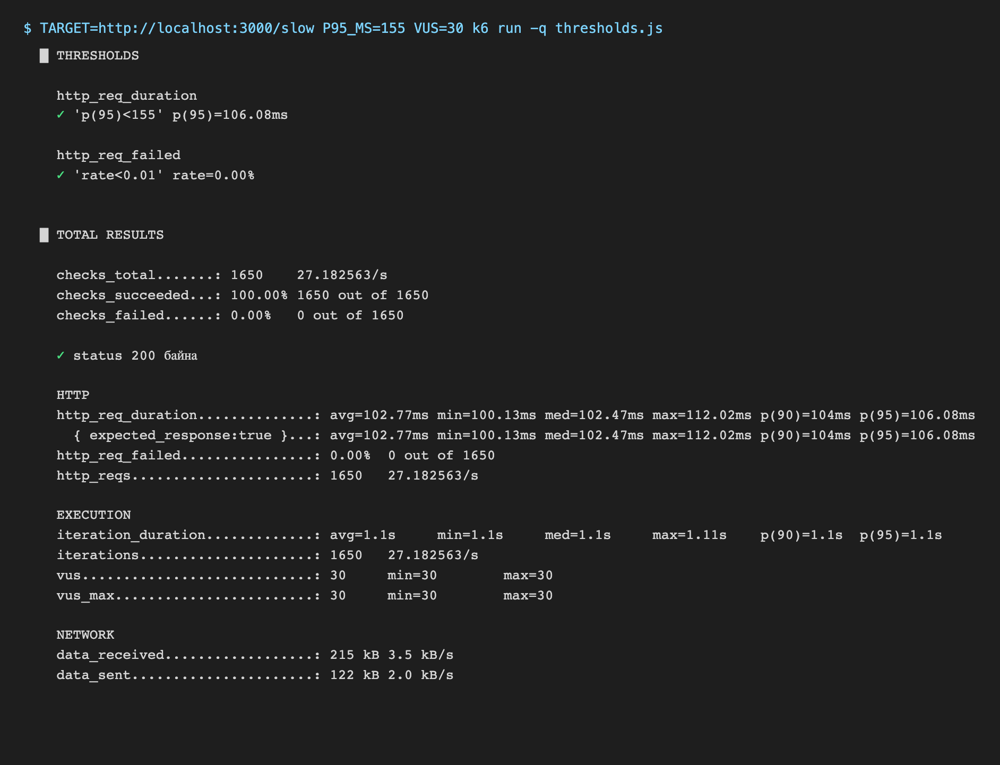

# Лаб 2: Гүйцэтгэлийн хэмжүүрийг k6-аар хэмжих

**F.CSA313 — Программ хангамжийн чанарын баталгаа ба тест (2026)**

| | |
|---|---|
| **Оюутан** | Д.Алтанбагана |
| **Оюутны код** | B222270827 |

## Орчин

```
$ k6 version
k6 v2.4.0 (commit/devel, go1.27.4, darwin/arm64)
```

- macOS (Apple M2, 8 цөм). k6-г `brew install k6` командаар суулгасан.
- **Тестэлсэн бай:** зөвхөн зөвшөөрөгдсөн хоёр бай руу тест хийсэн. (1) `https://test.k6.io`. (2) Өөрийн машин дээр ажилласан локал сервер `http://localhost:3000` ([`server/server.js`](server/server.js)).
- **Анхааруулга:** `test.k6.io` одоо k6-ийн шинэ албан ёсны дадлагын сайт `quickpizza.grafana.com` руу **302 redirect** хийдэг. k6 redirect-ийг автоматаар дагадаг тул нэг итерацид **2 HTTP хүсэлт** (302 + 200) тоологдоно. Тиймээс `http_reqs` нь `iterations`-ээс 2 дахин их, `http_req_duration` нь хоёр хүсэлтийн дундаж байна.

## Файлын бүтэц

| Файл | Зорилго |
|---|---|
| [`script.js`](script.js) | Алхам 2: baseline тест (тогтмол VU, `test.k6.io`) |
| [`stages.js`](stages.js) | Алхам 3: ачааллыг шатлан өсгөх (5 → 30 → 100 → 0 VU) |
| [`thresholds.js`](thresholds.js) | Алхам 4: SLO-г threshold болгож PASS/FAIL шалгах |
| [`local.js`](local.js), [`server/server.js`](server/server.js) | Алхам 5: локал сервер ба түүн рүү хийх тест |
| [`results/`](results/) | k6-ийн **бүтэн текст гаралт** (README-ийн бүх тоо эндээс авсан) |
| [`screenshots/`](screenshots/) | Summary гаралтын дэлгэцийн зураг |

## Алхам 2: Baseline хэмжилт (5 VU)

`k6 run script.js` → [`results/run-baseline-30s.txt`](results/run-baseline-30s.txt) (30 секунд). Мөн Алхам 3-т 1 минут ажиллуулсан → [`results/run-05vu.txt`](results/run-05vu.txt).

| Хэмжүүр | Summary-гийн мөр | 30s ажиллуулалт | 1m ажиллуулалт |
|---|---|---|---|
| Latency avg | `http_req_duration` avg | 156.61ms | 156.2ms |
| Latency p90 | `http_req_duration` p(90) | 241.85ms | 235.56ms |
| Latency p95 | `http_req_duration` p(95) | 250.77ms | **237ms** |
| Throughput | `http_reqs` | 220 нийт, 7.33 req/s | 460 нийт, 7.52 req/s |
| Error rate (POFOD) | `http_req_failed` | 0.00% (0 / 220) | 0.00% (0 / 460) |

**Baseline p95 = 237ms.** Удаан (1 минут) ажилласан тул энэ хэмжилтийг илүү найдвартай гэж үзсэн.

## Алхам 3: Ачааллыг өсгөх — 5 / 30 / 100 VU

Түвшин бүрийг `script.js`-ээр **тусад нь**, 1 минутаар, дараалан ажиллуулсан.

### test.k6.io

| VU | p90 | p95 | Throughput (`http_reqs`) | Error rate | Гаралт |
|---|---|---|---|---|---|
| 5 | 235.56ms | 237ms | 7.52 req/s (460) | 0.00% | [run-05vu.txt](results/run-05vu.txt) |
| 30 | 286.38ms | 510.87ms | 40.41 req/s (2476) | 0.00% | [run-30vu.txt](results/run-30vu.txt) |
| 100 | 239.8ms | 248.16ms | 145.60 req/s (8916) | 0.00% | [run-100vu.txt](results/run-100vu.txt) |

100 VU-ийн p95 (248ms) нь 30 VU-ийнхаас (510ms) бага гарсан нь логикгүй санагдсан. Тиймээс хоёуланг нь **давтан** хэмжсэн:

| VU | p90 | p95 | Throughput | Error rate | Гаралт |
|---|---|---|---|---|---|
| 30 (давтан) | 440.87ms | 1.12s | 38.98 req/s (2418) | 0.00% | [run-30vu-repeat.txt](results/run-30vu-repeat.txt) |
| 100 (давтан) | 454.66ms | 1.11s | 128.99 req/s (7934) | 0.00% | [run-100vu-repeat.txt](results/run-100vu-repeat.txt) |

**Stages** (`k6 run stages.js`, нийт 2.5 минут, нэгтгэсэн нэг summary): p90 = 334.36ms, p95 = 900.54ms, 41.30 req/s, error 0.00%. Гаралт: [run-stages.txt](results/run-stages.txt).

### Локал сервер (тогтвортой орчин)

Гадаад сайтын үр дүн хэт их хэлбэлзэж байсан тул ижил туршилтыг локал сервер дээр 30 секундээр давтсан (`ENDPOINT=... k6 run --vus N --duration 30s local.js`). `/cpu` endpoint нь хүсэлт бүрт ~20ms CPU ачаалал үүсгэдэг. Node.js нэг thread-тэй тул зэрэг ирсэн хүсэлтүүд дараалалд ордог.

| Endpoint | VU | p90 | p95 | Throughput | Error rate |
|---|---|---|---|---|---|
| `/` (шууд хариу) | 5 | 1.36ms | 1.78ms | 4.98 req/s | 0.00% |
| `/` | 30 | 3.22ms | 3.54ms | 29.81 req/s | 0.00% |
| `/` | 100 | 3.93ms | 4.79ms | 99.70 req/s | 0.00% |
| `/slow` (100ms хүлээлт) | 5 | 103.16ms | 103.29ms | 4.53 req/s | 0.00% |
| `/slow` | 30 | 104.42ms | 105.06ms | 27.15 req/s | 0.00% |
| `/slow` | 100 | 108.61ms | 110.37ms | 90.37 req/s | 0.00% |
| `/cpu` (20ms CPU) | 5 | 21.1ms | 21.65ms | 4.88 req/s | 0.00% |
| `/cpu` | 30 | 24.56ms | 49.92ms | 28.63 req/s | 0.00% |
| `/cpu` | 100 | **1s** | **1s** | **48.20 req/s** | 0.00% |

Гаралт: `results/local-<endpoint>-<VU>vu.txt` (жишээ нь [local-cpu-100vu.txt](results/local-cpu-100vu.txt)).

**Хэрэглэгчийн туршлага муудаж эхэлсэн цэг:** `/cpu` дээр 30 VU-ээс p95 нь 21.65ms-ээс 49.92ms болж 2 дахин өссөн. 100 VU-д throughput **~48 req/s дээр тулж** зогссон. Онолын дээд хязгаар нь 1000ms ÷ 20ms = 50 req/s. Үүнээс хойш нэмэгдсэн хэрэглэгч бүр зөвхөн дараалал уртасгаж, p95 нь **1 секунд** болсон. `test.k6.io`-д тодорхой ханалтын цэг ажиглагдаагүй, учир нь 100 VU-д ч throughput шугаман өссөн (7.5 → 40 → 146 req/s). Харин p95 нь 30 VU-ээс эхлэн 237ms-ээс дээш гарч, 0.5–1.1s хооронд хэлбэлзсэн.

## Алхам 4: Thresholds (SLO)

**SLO-г ингэж тодорхойлсон:** baseline p95 = 237ms ([run-05vu.txt](results/run-05vu.txt)) × 1.5 ≈ **p95 < 356ms**, мөн **error rate < 1%**. Гадаад сүлжээний хэвийн хэлбэлзэлд 50%-ийн зай үлдээх зорилгоор ×1.5-ийг сонгосон. Ингэснээр бага ачаалалтай үеийн гүйцэтгэлээс мэдэгдэхүйц муудвал тест FAIL болно. Локал серверийн `/slow` endpoint-д мөн адил baseline p95 = 103.29ms ([local-slow-05vu.txt](results/local-slow-05vu.txt)) × 1.5 ≈ **p95 < 155ms** гэж тогтоосон.

| Туршилт | Threshold | Үр дүн | exit code | Гаралт |
|---|---|---|---|---|
| test.k6.io, 30 VU | p95 < 356ms | ❌ FAIL — p95 = 1.23s | 99 | [thresholds-30vu-slo356.txt](results/thresholds-30vu-slo356.txt) |
| test.k6.io, 5 VU | p95 < 356ms | ❌ FAIL — p95 = 430.61ms | 99 | [thresholds-05vu-slo356.txt](results/thresholds-05vu-slo356.txt) |
| test.k6.io, 5 VU, санаатай хатуу | p95 < 50ms | ❌ FAIL — p95 = 241.22ms | 99 | [thresholds-strict-50ms.txt](results/thresholds-strict-50ms.txt) |
| **локал `/slow`, 30 VU** | **p95 < 155ms** | ✅ **PASS — p95 = 106.08ms** | **0** | [thresholds-local-slow-pass.txt](results/thresholds-local-slow-pass.txt) |
| локал `/slow`, 30 VU, санаатай хатуу | p95 < 50ms | ❌ FAIL — p95 = 104.71ms | 99 | [thresholds-local-slow-strict-fail.txt](results/thresholds-local-slow-strict-fail.txt) |

Бүх туршилтад `rate<0.01` (error rate) threshold хангагдсан. Threshold зөрчигдөхөд k6 `thresholds on metrics 'http_req_duration' have been crossed` гэж бичээд **exit code 99** буцаадаг. CI pipeline ийм 0-ээс ялгаатай кодыг хараад build-ийг зогсоодог (quality gate).

## Дэлгэцийн зургууд

Зургуудыг `results/` доторх бодит гаралтын файлуудаас терминал хэлбэрээр зурж үүсгэсэн. Тоонууд нь файлуудтай яг ижил.

| | |
|---|---|
| 5 VU (baseline) | [01-run-05vu.png](screenshots/01-run-05vu.png) |
| 30 VU | [02-run-30vu.png](screenshots/02-run-30vu.png) |
| 100 VU | [03-run-100vu.png](screenshots/03-run-100vu.png) |
| Stages | [04-run-stages.png](screenshots/04-run-stages.png) |
| SLO FAIL (test.k6.io) | [05-thresholds-test-k6-fail.png](screenshots/05-thresholds-test-k6-fail.png) |
| SLO PASS (локал) | [06-thresholds-local-pass.png](screenshots/06-thresholds-local-pass.png) |
| SLO хатуу FAIL (локал) | [07-thresholds-local-strict-fail.png](screenshots/07-thresholds-local-strict-fail.png) |
| `/cpu` 100 VU ханалт | [08-local-cpu-100vu.png](screenshots/08-local-cpu-100vu.png) |



## Дүгнэлт

Ачаалал 5-аас 100 VU болж өсөхөд `test.k6.io` дээр throughput бараг шугам өссөн (7.5 → 146 req/s), алдаа гараагүй. Гэвч p95 latency 30 VU-ээс эхлэн baseline-аас (237ms) 2–5 дахин өсөж 0.5–1.1s хооронд хэлбэлзсэн бол дундаж (avg) нь 156–239ms хооронд л байсан. Энэ нь лекцэд үзсэн "дундаж нь сүүлийг (tail) нуудаг, тиймээс p95/p99-ийг харах ёстой" гэдгийг баталж байгаа юм. Нэг ижил 100 VU тест эхний удаад p95 = 248ms, хоёр дахь удаад 1.11s гарсан нь гадаад сайт руу хийсэн хэмжилт сүлжээ, цаг хугацаанаас хүчтэй хамаардаг тул нэг удаагийн хэмжилтээр дүгнэх нь эрсдэлтэйг харуулж байна. Локал сервер дээр зөрчил маш тод харагдсан учир: `/cpu` endpoint 100 VU-д throughput ~48 req/s-д тулж, p95 нь 21ms-ээс 1 секунд болсон. Энэ нь лекцийн "10 хэрэглэгчтэй үед 2с, 100 хэрэглэгчтэй үед 4с" буюу **throughput-ийн хязгаарт хүрсний дараа нэмэгдсэн ачаалал зөвхөн latency-г өсгөдөг** гэсэн ойлголтыг шууд баталсан. Харин зөвхөн хүлээдэг `/slow` endpoint-ийн p95 100 VU-д ч ердөө 7ms-ээр өссөн нь хүлээлт (I/O) ба тооцоолол (CPU) хоёр ачааллын дор огт өөр ажилладгийг харуулсан. Baseline × 1.5 аргаар тодорхойлсон SLO (p95 < 356ms) `test.k6.io` дээр хангагдаагүй, харин локал `/slow` дээрх SLO (p95 < 155ms) 30 VU-д хангагдаж PASS болсон. Threshold-ийг санаатайгаар 50ms болгоход тест exit code 99-тэй FAIL болсон нь CI дээрх quality gate-ийн ажиллах зарчмыг харуулсан. Error rate (POFOD) бүх туршилтад 0% байсан тул энэ ачааллын түвшинд систем "удааширсан ч унаагүй" буюу availability хангагдсан гэж дүгнэлээ.

## Ажиллуулах

```bash
k6 run script.js                                  # baseline
k6 run --vus 30 --duration 1m script.js           # тодорхой түвшин
k6 run stages.js                                  # шатлан өсгөх
k6 run thresholds.js                              # SLO шалгах (test.k6.io, 30 VU)

node server/server.js                             # локал сервер (тусдаа терминалд)
ENDPOINT=/cpu k6 run --vus 100 --duration 30s local.js
TARGET=http://localhost:3000/slow P95_MS=155 VUS=30 k6 run thresholds.js
```
